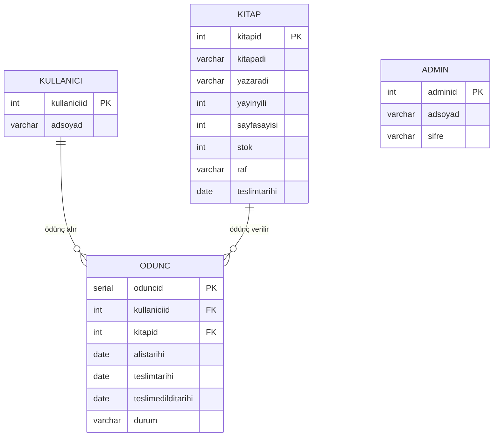

<div align="center">

# 📚 Kütüphane Yönetim Sistemi

Kitapları, üyeleri ve ödünç işlemlerini tek ekrandan yöneten masaüstü uygulaması.


</div>

---

## İçindekiler

- [Proje Hakkında](#proje-hakkında)
- [Özellikler](#özellikler)
- [Teknolojiler](#teknolojiler)
- [Veritabanı Yapısı](#veritabanı-yapısı)
- [Kurulum](#kurulum)
- [Çalıştırma](#çalıştırma)
- [Kullanım](#kullanım)
- [Proje Yapısı](#proje-yapısı)
- [Geliştirme Fikirleri](#geliştirme-fikirleri)

## Proje Hakkında

Bu proje, küçük bir kütüphanenin günlük işlerini dijitale taşımak için geliştirildi. Yönetici giriş yaptıktan sonra kitap ekleyip silebilir, kütüphaneye üye kaydedebilir, kitapları üyelere ödünç verip geri teslim alabilir. Bir kitabın rafta mı yoksa kimde olduğu tablodan anında görülür; ödünç verme ve teslim alma işlemlerinde stok otomatik güncellenir.

Arayüz Java Swing ile yazıldı, veriler PostgreSQL'de tutulur. Ek bir framework gerekmez; JDK ve PostgreSQL sürücüsü yeterlidir.

## Özellikler

### 🔐 Yönetici Girişi
- Ad soyad ve şifre ile giriş, bilgiler veritabanındaki `admin` tablosundan doğrulanır
- Boş alan ve hatalı giriş için ekranda uyarı
- Tek tıkla çıkış

### 📖 Kitap Yönetimi
- ID, ad, yazar, yayın yılı, sayfa sayısı, stok, raf konumu ve teslim tarihi ile kitap ekleme
- Tüm kitapları tablo halinde listeleme
- Her kitap için **durum** (Rafta / Ödünç Verildi) ve **konum** (raf numarası ya da kitabı alan üye)
- Onay penceresiyle kitap silme

### 👥 Üye Yönetimi
- ID ve ad soyad ile üye ekleme
- Üye listesi ve onaylı silme
- **Kitapları Göster:** üyenin elindeki kitapları alış ve teslim tarihleriyle görme

### 🔄 Ödünç İşlemleri
- Rafta olan ve stoğu bulunan kitabı üyeye ödünç verme
- Üyenin kitap listesinden **Teslim Al** ile iade alma
- Ödünç verilince stok bir azalır, teslim alınınca bir artar
- Her işlem alış tarihi, son teslim tarihi ve gerçek teslim tarihiyle kayıt altına alınır

## Teknolojiler

| Katman | Teknoloji |
|---|---|
| Dil | Java 8+ (JDK 22 ile geliştirildi) |
| Arayüz | Java Swing (`CardLayout`, `JTable`, `JDialog`) |
| Veritabanı | PostgreSQL |
| Bağlantı | JDBC, PostgreSQL sürücüsü 42.7.8 (projeye dahil) |
| Güvenlik | Tüm sorgular `PreparedStatement` ile (SQL enjeksiyonuna karşı) |
| Geliştirme ortamı | IntelliJ IDEA |

## Veritabanı Yapısı



Bir kitap ya da üye silindiğinde ona bağlı ödünç kayıtları da silinir (`ON DELETE CASCADE`).

## Kurulum

### Gereksinimler

- **Java JDK 8 veya üzeri**
- **PostgreSQL** (yerelde, varsayılan port 5432)
- İsteğe bağlı: **IntelliJ IDEA**

PostgreSQL JDBC sürücüsü (`postgresql-42.7.8.jar`) depoda bulunur, ayrıca indirmeniz gerekmez.

### 1. Depoyu klonlayın

```bash
git clone https://github.com/melisaciceksoyubey/LibrarySystem.git
cd LibrarySystem
```

### 2. Veritabanını kurun

Hazır betik veritabanını, dört tabloyu ve örnek verileri tek seferde oluşturur:

```bash
psql -U postgres -f database_setup.sql
```

Betik şunları ekler:
- Yönetici: **Melisa / 1234**
- 3 örnek üye: Ahmet Yılmaz, Ayşe Demir, Mehmet Kaya
- 3 örnek kitap: *Suç ve Ceza*, *Savaş ve Barış*, *1984*

> pgAdmin kullanıyorsanız `database_setup.sql` dosyasını Query Tool'da açıp çalıştırabilirsiniz. `\c` satırı yalnızca psql'de çalışır; pgAdmin'de önce `kutuphaneSistemi` veritabanını seçip betiğin geri kalanını çalıştırın.

### 3. Bağlantı bilgilerini girin

Uygulama bağlantı bilgilerini **ortam değişkenlerinden** okur, böylece şifre koda yazılmaz. Tanımlanmayan değişken için varsayılan değer kullanılır:

| Değişken | Varsayılan |
|---|---|
| `DB_URL` | `jdbc:postgresql://localhost:5432/kutuphaneSistemi` |
| `DB_USER` | `postgres` |
| `DB_PASSWORD` | `postgres` |

PostgreSQL şifreniz `postgres` değilse `DB_PASSWORD` değişkenini tanımlayın:

- **IntelliJ IDEA:** *Run → Edit Configurations → Environment variables* alanına `DB_PASSWORD=şifreniz`
- **Windows (PowerShell):** `$env:DB_PASSWORD="şifreniz"`
- **macOS / Linux:** `export DB_PASSWORD=şifreniz`

## Çalıştırma

### IntelliJ IDEA ile

1. *File → Open* ile proje klasörünü açın. PostgreSQL sürücüsü kütüphane olarak hazır tanımlıdır.
2. `src/LibraryApp.java` dosyasını açın.
3. `main` metodunun yanındaki ▶ simgesine tıklayın.

### Komut satırı ile

Windows:
```cmd
javac -encoding UTF-8 -cp postgresql-42.7.8.jar -d out src\*.java
java -cp "out;postgresql-42.7.8.jar" LibraryApp
```

macOS / Linux:
```bash
javac -encoding UTF-8 -cp postgresql-42.7.8.jar -d out src/*.java
java -cp "out:postgresql-42.7.8.jar" LibraryApp
```

> Bazı dosya adlarında Türkçe karakter olduğu için `-encoding UTF-8` parametresi gereklidir.

## Kullanım

1. Uygulama giriş ekranıyla açılır. **Melisa / 1234** ile giriş yapın.
2. Soldaki menüden **Kitap Yönetimi**'ni seçin:
   - Formu doldurup **Kitap Ekle**'ye basın. Tarih `YYYY-AA-GG` biçiminde girilir (örn. `2025-12-31`).
   - Listede bir kitabın yanındaki **Ödünç Ver** ile üye ID'si ve teslim tarihini girin.
3. **Kullanıcı Yönetimi**'nde üye ekleyin ya da silin.
   - **Kitapları Göster** ile üyenin elindeki kitapları açın, iade edilen kitap için **Teslim Al**'a basın.
4. İşiniz bitince sağ üstteki **Çıkış Yap** ile giriş ekranına dönün.

## Proje Yapısı

```
LibrarySystem/
├── src/
│   ├── LibraryApp.java                  # Swing arayüzü: giriş, kitap ve üye ekranları
│   ├── Main.java                        # Başlangıç noktası, LibraryApp'i açar
│   ├── DBConnection.java                # PostgreSQL bağlantısı (ortam değişkenleriyle)
│   │
│   ├── Admin.java                       # Model: yönetici
│   ├── Kitap.java                       # Model: kitap
│   ├── Kullanıcı.java                   # Model: üye
│   ├── OduncBilgi.java                  # Model: ödünç kaydı (kitap + üye bilgisiyle)
│   │
│   ├── AdminVeriTabaniOluştur.java      # Veri erişimi: yönetici ekleme, giriş kontrolü
│   ├── KitapVeriTabaniOluştur.java      # Veri erişimi: kitap ekleme, listeleme, silme
│   ├── KullanıcıVeriTabaniOluştur.java  # Veri erişimi: üye ekleme, listeleme, silme
│   └── OduncVeriTabaniOluştur.java      # Veri erişimi: ödünç verme, teslim alma, konum
│
├── database_setup.sql                   # Veritabanı, tablolar ve örnek veriler
├── postgresql-42.7.8.jar                # PostgreSQL JDBC sürücüsü
├── KutuphaneSistem.iml                  # IntelliJ modül dosyası
└── README.md
```

Kod üç katmana ayrılmıştır: **model** sınıfları veriyi taşır, **VeriTabaniOluştur** sınıfları SQL işlemlerini yapar, **LibraryApp** ise kullanıcı arayüzünü çizer.

## Geliştirme Fikirleri

- [ ] Yönetici şifrelerini düz metin yerine hash'leyerek saklamak (örn. BCrypt)
- [ ] Kitap ve üye listesinde arama ve filtreleme
- [ ] Kitap bilgilerini düzenleme ekranı
- [ ] Teslim tarihi geçen kitapları vurgulayan gecikme raporu
- [ ] Tarih alanları için takvimden seçim

---

<div align="center">

Eğitim amacıyla geliştirilmiştir · **Melisa Çiçek**

Soru ve önerileriniz için [issue](https://github.com/melisaciceksoyubey/LibrarySystem/issues) açabilirsiniz.

</div>
